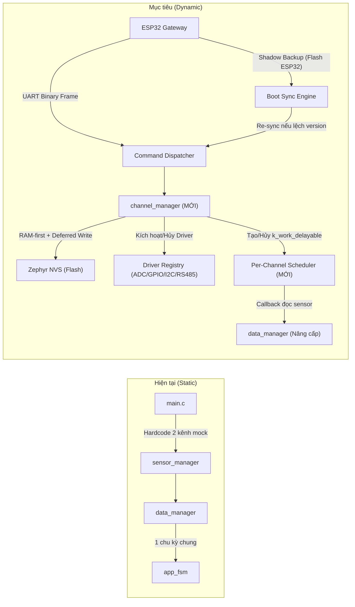
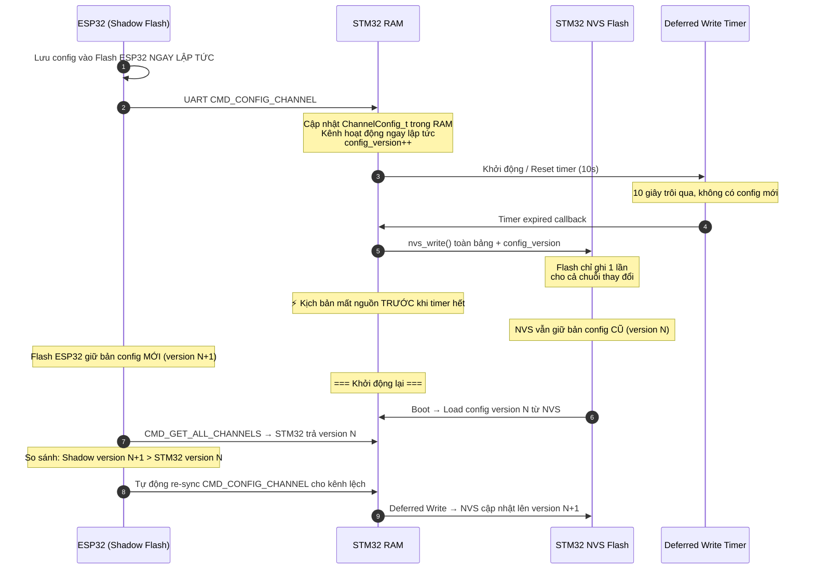
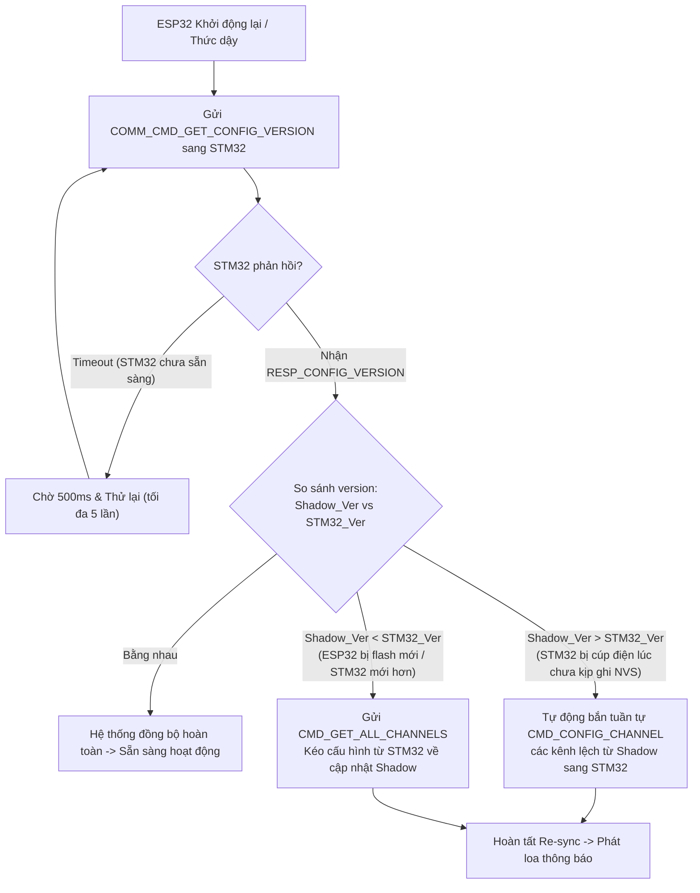
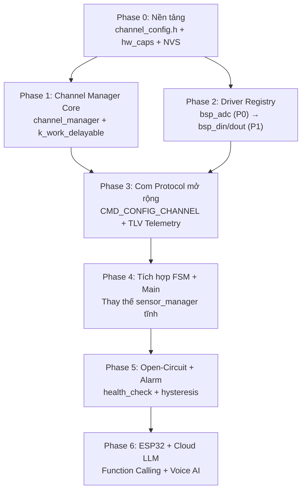

# Plan hiện thực hệ thống Dynamic Channel Configuration

## Tổng quan mục tiêu
Biến Datalogger từ hệ thống cấu hình tĩnh (hardcode `sensor_manager_register_channel()` trong `main.c`) thành hệ thống cấu hình động runtime, cho phép AI (qua Voice/App → Cloud LLM → ESP32 Gateway → UART → STM32) thêm/sửa/xóa/hoán đổi kênh đo và kênh điều khiển I/O mà không cần flash lại firmware.

---

## Kiến trúc hiện tại vs. Kiến trúc mục tiêu



## Chiến lược lưu trữ cấu hình: Deferred Write + ESP32 Shadow Backup

> [!IMPORTANT]
> Nguyên tắc cốt lõi: **RAM là nguồn sự thật (Source of Truth) khi đang chạy. Flash chỉ là bản sao lưu bền vững.**

### Mô hình hoạt động



### Ba thành phần của chiến lược

| Thành phần | Vị trí | Vai trò | Ghi khi nào |
|---|---|---|---|
| **RAM Table** (Primary) | STM32 SRAM | Source of Truth khi đang chạy. Kênh bắt đầu hoạt động ngay khi RAM được cập nhật. | Mỗi lệnh config → cập nhật ngay |
| **NVS Flash** (Durable Cache) | STM32 Flash nội | Bản sao lưu bền vững. Dùng khi khởi động lại mà ESP32 chưa kịp sync. | Chỉ ghi sau Deferred Timer (10s idle) |
| **Shadow Flash** (Backup) | ESP32 Flash (SPI NOR, 100K cycles) | Bản backup toàn vẹn nhất. Dùng để re-sync STM32 nếu NVS bị cũ hoặc corrupt. | ESP32 ghi ngay khi nhận response từ LLM |

### Config Version Counter

Mỗi lần bảng cấu hình thay đổi (bất kỳ kênh nào), bộ đếm `config_version` (uint32_t) tăng lên 1. Giá trị này được lưu kèm bảng cấu hình ở cả 3 nơi (RAM, NVS, Shadow). Khi boot:
- STM32 đọc NVS → lấy `version_stm32`
- ESP32 gửi `CMD_GET_ALL_CHANNELS` → nhận `version_stm32`
- ESP32 so sánh với `version_esp32` (Shadow)
- Bên nào có version **cao hơn** là bản đúng → bên kia đồng bộ theo

---

## Các Phase triển khai

### Phase 0 — Chuẩn bị nền tảng (Không thay đổi chức năng)

> [!IMPORTANT]
> Phase này không thêm tính năng mới, chỉ tái cấu trúc nền tảng để các Phase sau xây dựng trên đó.

#### Task 0.1: Định nghĩa `ChannelConfig_t` (Shared Header)

**File mới**: `src/services/channel_config.h`

Đây là cấu trúc dữ liệu trung tâm, dùng chung trên cả STM32 lẫn ESP32. Thiết kế theo đúng bản đặc tả trong tài liệu thiết kế của bạn:

```
┌─────────────────────────────────────────────────────┐
│  ChannelConfig_t  (packed, shared STM32 & ESP32)    │
├─────────────────────────────────────────────────────┤
│ uint8_t   channel_id          │ Vật lý: 0x01..0x12 │
│ uint8_t   interface_mode      │ ADC/DIG_IN/OUT/...  │
│ uint8_t   is_enabled          │ 0 or 1              │
│ uint16_t  sample_interval_ms  │ Chu kỳ lấy mẫu     │
│ uint8_t   metric_type         │ TEMP/HUMIDITY/PH/...│
│ uint8_t   unit_type           │ CELSIUS/FAHRENHEIT..│
│ uint8_t   calib_type          │ LINEAR/MODBUS/NONE  │
│ ─── union calib_params ───    │                     │
│   Nhánh ADC:                  │                     │
│     float scale_a             │                     │
│     float offset_b            │                     │
│     uint16_t raw_min_mv       │                     │
│     uint16_t raw_max_mv       │                     │
│   Nhánh Modbus:               │                     │
│     uint8_t  slave_id         │                     │
│     uint8_t  function_code    │                     │
│     uint16_t register_addr    │                     │
│     uint8_t  byte_swap_mode   │                     │
│ ─── end union ───             │                     │
│ float alarm_low               │                     │
│ float alarm_high              │                     │
│ float alarm_hysteresis        │                     │
└─────────────────────────────────────────────────────┘

┌─────────────────────────────────────────────────────┐
│  config_table_header_t  (packed, lưu kèm bảng)     │
├─────────────────────────────────────────────────────┤
│ uint32_t  magic_number        │ 0x55AA1234          │
│ uint32_t  config_version      │ Bộ đếm tăng dần    │
│ uint8_t   active_count        │ Số kênh đang bật    │
│ uint32_t  crc32               │ CRC toàn bảng       │
└─────────────────────────────────────────────────────┘
```

Checklist thiết kế:
- [ ] Bọc toàn bộ struct trong `#pragma pack(push, 1)` / `#pragma pack(pop)`
- [ ] Định nghĩa `enum channel_interface_mode_t`: `MODE_DISABLED`, `MODE_ADC_SINGLE`, `MODE_DIGITAL_IN`, `MODE_PULSE_COUNTER`, `MODE_OUTPUT`, `MODE_I2C`, `MODE_RS485`, `MODE_RS232`, `MODE_UART`
- [ ] Định nghĩa `enum channel_metric_type_t`: `METRIC_NONE`, `METRIC_TEMPERATURE`, `METRIC_HUMIDITY`, `METRIC_CURRENT_4_20MA`, `METRIC_VOLTAGE`, `METRIC_PH`, `METRIC_SOIL_MOISTURE`, `METRIC_PRESSURE`, `METRIC_PULSE_COUNT`, ...
- [ ] Định nghĩa `enum channel_calib_type_t`: `CALIB_NONE`, `CALIB_LINEAR`, `CALIB_MODBUS_RTU`
- [ ] Định nghĩa `MAX_PHYSICAL_CHANNELS 18` (theo bảng chân vật lý)
- [ ] Thêm mảng const `channel_hw_capability_t hw_caps[MAX_PHYSICAL_CHANNELS]` — bảng tra cứu tĩnh mô tả mỗi cổng vật lý hỗ trợ những mode nào (để validate khi AI gửi lệnh cấu hình)

#### Task 0.2: Định nghĩa bảng ràng buộc chân vật lý (Pin Constraint Table)

**File mới**: `src/services/channel_hw_caps.h` + `channel_hw_caps.c`

Bảng `const` (ROM) chứa khả năng phần cứng của từng cổng:

```
Ví dụ:
CH_01 (PC2) → Chỉ hỗ trợ: MODE_ADC_SINGLE
CH_07 (PA5) → Hỗ trợ: MODE_ADC_SINGLE
CH_08 (PA5) → Hỗ trợ: MODE_PULSE_COUNTER
  → Ràng buộc: CH_07 và CH_08 MUTUAL EXCLUSIVE (cùng chân PA5)
CH_12 (PE5) → Chỉ hỗ trợ: MODE_OUTPUT
CH_15 (PC10/PC11) → Chỉ hỗ trợ: MODE_RS485
CH_17 (PB10/PB11) → Chỉ hỗ trợ: MODE_I2C
```

Checklist:
- [ ] Mỗi entry chứa: `channel_id`, `gpio_port`, `gpio_pin`, `allowed_modes` (bitmask), `conflict_group_id` (cùng group = cùng chân vật lý, chỉ 1 cái được active)
- [ ] Hàm `bool hw_caps_validate(uint8_t ch_id, uint8_t mode)` — kiểm tra mode có hợp lệ cho cổng này không
- [ ] Hàm `bool hw_caps_check_conflict(uint8_t ch_id, const ChannelConfig_t table[])` — kiểm tra xung đột với các kênh khác đang active

#### Task 0.3: Bật Zephyr NVS subsystem

**File sửa**: `prj.conf`

```ini
# Thêm vào prj.conf
CONFIG_NVS=y
CONFIG_FLASH=y
CONFIG_FLASH_MAP=y
CONFIG_FLASH_PAGE_LAYOUT=y
CONFIG_MPU_ALLOW_FLASH_WRITE=y
```

**File sửa**: Devicetree overlay — tạo partition `storage_partition` trên Flash nội STM32F407 (nếu chưa có)

Checklist:
- [X ] Xác nhận Flash layout STM32F407: Sector 0-3 (16KB mỗi cái), Sector 4 (64KB), Sector 5-11 (128KB) => 
- [ X] Chọn Sector cuối (ví dụ Sector 11, 128KB) làm NVS partition
- [ X] Kiểm tra `CONFIG_FLASH_PAGE_LAYOUT` có đúng với chip STM32F407 không

---

### Phase 1 — Channel Manager Core (Trái tim của hệ thống)

> [!IMPORTANT]
> Module mới `channel_manager` thay thế vai trò đăng ký tĩnh trong `main.c`, quản lý vòng đời (UNCONFIGURED → ACTIVE → SUSPENDED → STOPPING) của mỗi kênh.

**File mới**: `src/services/channel_manager.h` + `src/services/channel_manager.c`

#### Task 1.1: Cấu trúc runtime của mỗi kênh

```
┌──────────────────────────────────────────────────┐
│  channel_runtime_t (Trạng thái runtime 1 kênh)  │
├──────────────────────────────────────────────────┤
│ ChannelConfig_t           config                 │ ← Cấu hình từ NVS/UART
│ channel_state_t           state                  │ ← UNCONFIGURED/ACTIVE/STOPPING/...
│ float                     last_value             │ ← Giá trị đo gần nhất
│ bool                      is_valid               │ ← Dữ liệu hợp lệ?
│ uint16_t                  fault_code             │ ← Mã lỗi hiện tại
│ const sensor_driver_ops_t *driver_ops            │ ← Con trỏ tới driver
│ struct k_work_delayable   sample_work            │ ← Zephyr delayed work (mỗi kênh riêng)
└──────────────────────────────────────────────────┘
```

```
channel_manager_t:
├── channel_runtime_t       channels[MAX_PHYSICAL_CHANNELS]  (cấp phát tĩnh trong RAM)
├── config_table_header_t   header                           (magic, config_version, active_count, crc32)
├── struct k_mutex          config_lock                      (bảo vệ thao tác cấu hình)
├── struct nvs_fs           nvs_handle                       (handle Zephyr NVS)
├── bool                    nvs_valid                        (Flash đọc được không)
├── bool                    is_dirty                         (RAM đã thay đổi, chưa ghi Flash)
└── struct k_work_delayable deferred_save_work               (Timer 10s hoãn ghi Flash)
```

#### Task 1.2: API channel_manager

```c
/* Khởi tạo: Load cấu hình từ NVS, nếu CRC lỗi → load default */
void channel_manager_init(channel_manager_t *mgr);

/* Cấu hình 1 kênh (gọi từ UART command handler) */
int channel_manager_configure(channel_manager_t *mgr, const ChannelConfig_t *cfg);
  /* Bên trong (Cơ chế Chiến lược B):
   * 1. Lock mutex
   * 2. hw_caps_validate(cfg->channel_id, cfg->interface_mode)
   * 3. hw_caps_check_conflict(cfg->channel_id, ...)
   * 4. So sánh với RAM hiện tại (memcmp):
   *    - Nếu GIỐNG NHAU → Unlock mutex, trả về 0 (bỏ qua, không làm tốn tài nguyên)
   * 5. Nếu kênh đang ACTIVE → Dừng k_work_delayable cũ (k_work_cancel_delayable_sync)
   * 6. Cập nhật ChannelConfig_t vào RAM (channels[id].config = *cfg)
   * 7. Tăng mgr->header.config_version++
   * 8. Đánh dấu mgr->is_dirty = true
   * 9. Lookup driver_ops từ Driver Registry theo interface_mode
   * 10. Gọi driver_ops->init()
   * 11. Khởi động k_work_delayable lấy mẫu mới với interval = cfg->sample_interval_ms
   * 12. Chuyển state → ACTIVE
   * 13. KÍCH HOẠT / RESET TIMER DEFERRED WRITE (10 giây):
   *     k_work_reschedule(&mgr->deferred_save_work, K_SECONDS(10))
   * 14. Unlock mutex
   */

/* Tắt 1 kênh (khi rút sensor / disable từ AI) */
int channel_manager_disable(channel_manager_t *mgr, uint8_t channel_id);
  /* Tương tự: Hủy worker, xóa is_enabled trong RAM, tăng config_version, reset timer 10s */

/* Flush cưỡng bức RAM xuống Flash NVS ngay lập tức (khi chuẩn bị reboot hoặc lệnh từ ESP32) */
int channel_manager_flush_nvs(channel_manager_t *mgr);

/* Callback thực thi khi hết 10 giây không còn thay đổi cấu hình */
void channel_manager_deferred_save_handler(struct k_work *work);
  /* Bên trong:
   * 1. container_of(work) → lấy channel_manager_t
   * 2. Lock mutex
   * 3. Nếu !is_dirty → Unlock, thoát
   * 4. Tính CRC32 toàn bảng RAM
   * 5. nvs_write() từng channel bị thay đổi + nvs_write() header (version, crc32)
   * 6. mgr->is_dirty = false
   * 7. Unlock mutex
   */

/* Đọc giá trị tức thời của 1 kênh */
int channel_manager_read(channel_manager_t *mgr, uint8_t channel_id, float *out_value);

/* Lấy snapshot toàn bộ kênh đang active (thay thế sensor_manager_read_all) */
uint8_t channel_manager_get_snapshot(channel_manager_t *mgr, sensor_telemetry_snapshot_t *out);

/* Lấy bảng cấu hình hiện tại + header version (để ESP32 đối chiếu Shadow Sync) */
uint8_t channel_manager_get_config_table(channel_manager_t *mgr, config_table_header_t *out_header, ChannelConfig_t *out_table, uint8_t max_count);
```

#### Task 1.3: Per-Channel Scheduler (k_work_delayable)

Thay vì 1 timer chung quét tất cả, mỗi kênh có 1 `struct k_work_delayable` riêng:

```
Luồng thực thi:
channel_manager_configure()
  └→ k_work_init_delayable(&ch->sample_work, channel_sample_handler)
  └→ k_work_reschedule(&ch->sample_work, K_MSEC(cfg->sample_interval_ms))

channel_sample_handler(struct k_work *work):
  1. container_of(work) → lấy lại channel_runtime_t
  2. Gọi ch->driver_ops->read(&raw_value)
  3. Áp dụng calib: val = raw_value * scale_a + offset_b
  4. Kiểm tra alarm thresholds (có hysteresis)
  5. Cập nhật ch->last_value, ch->is_valid
  6. k_work_reschedule() chính nó → lặp lại chu kỳ
```

Checklist:
- [ ] `k_work_delayable` chạy trên Zephyr System Workqueue — cần tăng `CONFIG_SYSTEM_WORKQUEUE_STACK_SIZE` (hiện 2048, nên nâng lên 4096)
- [ ] Khi disable kênh: gọi `k_work_cancel_delayable_sync()` (chờ work handler kết thúc) trước khi reset state
- [ ] Mutex `config_lock` chỉ giữ khi thay đổi cấu hình, KHÔNG giữ khi đọc giá trị (tránh block sampling)

#### Task 1.4: NVS Persistence

Mỗi kênh lưu vào NVS với key = `NVS_CH_BASE_ID + channel_id`:
```
NVS Key 0x0100 → ChannelConfig_t của CH_01
NVS Key 0x0101 → ChannelConfig_t của CH_02
...
NVS Key 0x0111 → ChannelConfig_t của CH_18
NVS Key 0x0200 → Magic Number + CRC32 toàn bảng (integrity check)
```

Startup flow:
```
channel_manager_init():
  1. nvs_mount() → Mở phân vùng Flash
  2. Đọc Magic + CRC32 từ key 0x0200
  3. Nếu hợp lệ → Đọc từng key 0x0100..0x0111 vào RAM
  4. Nếu CRC lỗi / Magic sai → Nạp Default Safe Config (tất cả DISABLED)
  5. Với mỗi kênh có is_enabled=1 → Tự động kích hoạt driver + scheduler
```

---

### Phase 2 — Driver Registry (Ánh xạ Mode → Driver)

> [!NOTE]
> Tầng này giải quyết câu hỏi: "Khi AI nói cắm sensor nhiệt độ vào CH_01 (ADC), STM32 lấy driver nào để đọc?"

**File mới**: `src/services/driver_registry.h` + `src/services/driver_registry.c`

#### Task 2.1: Bảng tra cứu Driver theo interface_mode

```c
typedef struct {
    channel_interface_mode_t  mode;
    const sensor_driver_ops_t *ops;     /* Có thể NULL nếu mode chưa implement */
    bool (*hw_init)(uint8_t channel_id); /* Init phần cứng cụ thể cho cổng này */
    void (*hw_deinit)(uint8_t channel_id); /* Giải phóng phần cứng khi disable */
} driver_registry_entry_t;
```

Bảng tra cứu const:
```
MODE_ADC_SINGLE    → bsp_adc_ops     + bsp_adc_init_channel()
MODE_DIGITAL_IN    → bsp_din_ops     + bsp_din_init_channel()
MODE_PULSE_COUNTER → bsp_pulse_ops   + bsp_pulse_init_channel()
MODE_OUTPUT        → bsp_dout_ops    + bsp_dout_init_channel()
MODE_I2C           → NULL (driver cụ thể phụ thuộc metric_type)
MODE_RS485         → bsp_rs485_ops   + bsp_rs485_init()
```

#### Task 2.2: BSP Driver mới cần viết

| Driver | File | Mô tả | Ưu tiên |
|--------|------|--------|---------|
| `bsp_adc` | `src/bsp/bsp_adc_zephyr.c` | Đọc ADC Zephyr API cho từng channel riêng biệt | **P0 (Bắt buộc)** |
| `bsp_din` | `src/bsp/bsp_din_zephyr.c` | Đọc trạng thái Digital Input (Opto EL3H7) | P1 |
| `bsp_dout` | `src/bsp/bsp_dout_zephyr.c` | Điều khiển Digital Output (MOSFET NCE6020AK) | P1 |
| `bsp_pulse` | `src/bsp/bsp_pulse_zephyr.c` | Đếm xung từ Opto HCPL-0630 (Timer Input Capture) | P2 |
| `bsp_rs485` | `src/bsp/bsp_rs485_zephyr.c` | Giao tiếp Modbus RTU qua USART3 | P2 |
| `bsp_i2c_sensor` | `src/bsp/bsp_i2c_sensor_zephyr.c` | Đọc cảm biến I2C (SHT3x, BME280...) | P2 |

Checklist:
- [x] Mỗi BSP driver phải implement đầy đủ 4 hàm trong `sensor_driver_ops_t`: `init`, `read`, `health_check`, `inject_fault`
- [x] `bsp_adc`: Sử dụng Zephyr ADC API (`adc_channel_setup()`, `adc_read()`) — KHÔNG dùng HAL trực tiếp
- [x] `bsp_dout`: Hàm `read` trả về trạng thái hiện tại (ON/OFF), hàm riêng `bsp_dout_set()` để điều khiển

---

### Phase 3 — Mở rộng Com Protocol (Lệnh cấu hình động)

> [!IMPORTANT]
> Thêm các Command ID mới vào `com_protocol.h` để ESP32 ra lệnh cấu hình kênh.

**File sửa**: `src/services/com_protocol.h`

#### Task 3.1: Thêm Command IDs

```c
/* Nhóm cấu hình kênh động (0x10 - 0x1F) */
COMM_CMD_CONFIG_CHANNEL      = 0x10, /* ESP32 → STM32: Cấu hình/Cập nhật 1 kênh */
COMM_CMD_DISABLE_CHANNEL     = 0x11, /* ESP32 → STM32: Tắt 1 kênh */
COMM_CMD_GET_CHANNEL_CONFIG  = 0x12, /* ESP32 → STM32: Truy vấn cấu hình 1 kênh */
COMM_CMD_RESP_CHANNEL_CONFIG = 0x92, /* STM32 → ESP32: Trả cấu hình 1 kênh */
COMM_CMD_GET_ALL_CHANNELS    = 0x13, /* ESP32 → STM32: Truy vấn toàn bộ bảng + header */
COMM_CMD_RESP_ALL_CHANNELS   = 0x93, /* STM32 → ESP32: Trả toàn bộ bảng + header */
COMM_CMD_SWAP_CHANNELS       = 0x14, /* ESP32 → STM32: Hoán đổi 2 kênh */
COMM_CMD_FACTORY_RESET       = 0x15, /* ESP32 → STM32: Reset về cấu hình gốc */
COMM_CMD_GET_CONFIG_VERSION  = 0x16, /* ESP32 → STM32: Kiểm tra nhanh version hiện tại */
COMM_CMD_RESP_CONFIG_VERSION = 0x96, /* STM32 → ESP32: Trả version hiện tại (4 byte) */
COMM_CMD_FLUSH_CONFIG_NVS    = 0x17, /* ESP32 → STM32: Ép ghi RAM xuống NVS ngay lập tức */

/* Nhóm điều khiển Digital Output (0x18 - 0x1F) */
COMM_CMD_SET_OUTPUT          = 0x18, /* ESP32 → STM32: Bật/Tắt cổng Output */
COMM_CMD_GET_OUTPUT_STATE    = 0x19, /* ESP32 → STM32: Đọc trạng thái Output */
COMM_CMD_RESP_OUTPUT_STATE   = 0x99, /* STM32 → ESP32: Trả trạng thái Output */
```

#### Task 3.2: Payload structs mới (packed)

```c
#pragma pack(push, 1)

/* Payload CMD_CONFIG_CHANNEL (0x10) */
typedef struct {
    ChannelConfig_t config; /* Toàn bộ cấu hình kênh */
} comm_payload_config_channel_t;

/* Payload CMD_DISABLE_CHANNEL (0x11) */
typedef struct {
    uint8_t channel_id;
} comm_payload_disable_channel_t;

/* Payload CMD_RESP_CONFIG_VERSION (0x96) */
typedef struct {
    uint32_t config_version;
    uint8_t  active_channels_count;
    uint8_t  is_dirty; /* 1 nếu còn đang chờ ghi NVS */
} comm_payload_config_version_t;

/* Payload CMD_SWAP_CHANNELS (0x14) */
typedef struct {
    uint8_t channel_id_a;
    uint8_t channel_id_b;
} comm_payload_swap_channels_t;

/* Payload CMD_SET_OUTPUT (0x18) */
typedef struct {
    uint8_t channel_id;  /* CH_12, CH_13, CH_14 */
    uint8_t output_state; /* 0: OFF, 1: ON */
} comm_payload_set_output_t;

#pragma pack(pop)
```

#### Task 3.3: Nâng cấp Telemetry Payload

Payload `COMM_CMD_RESP_TELEMETRY` hiện tại hardcode 3 trường (`temperature`, `humidity`, `current_loop_mA`). Cần chuyển sang **format TLV động**:

```
Payload mới (TLV array):
┌─────┬────────┬───────────────────┐
│ Tag │ Length │ Value             │
│ 1B  │ 1B     │ Length bytes      │
├─────┼────────┼───────────────────┤
│0x01 │ 0x04   │ float temperature │  ← CH_01 đang active
│0x04 │ 0x04   │ float current_mA  │  ← CH_04 đang active
│0x0C │ 0x01   │ uint8_t relay_st  │  ← CH_12 relay state
│...  │ ...    │ ...               │
└─────┴────────┴───────────────────┘

Trong đó Tag = channel_id (0x01..0x12)
```

Checklist:
- [x] Hàm đóng gói TLV: `uint16_t comm_tlv_encode_channels(const comm_channel_entry_t *entries, uint8_t count, uint8_t *out_buf, uint16_t max_len)`
- [x] Hàm giải mã TLV (phía ESP32): `uint8_t comm_tlv_decode_channels(...)`, bỏ qua Tag/Length lạ (Forward Compatibility)
- [x] `COMM_MAX_PAYLOAD_LEN` 128 byte — Compact wire format 7B header + N*6B (18 kênh = 115B <= 128B). OK.
- [x] Handler lệnh `COMM_CMD_CONFIG_CHANNEL` (0x10) tích hợp FSM và map mã lỗi NACK (`COMM_ERR_PIN_CONFLICT`, `COMM_ERR_UNSUPPORTED_MODE`).
- [x] Handler lệnh `COMM_CMD_DISABLE_CHANNEL` (0x11).
- [x] Handler lệnh `COMM_CMD_GET_CHANNEL_CONFIG` (0x12).
- [x] Handler lệnh `COMM_CMD_GET_CONFIG_VERSION` (0x16).
- [x] Handler lệnh `COMM_CMD_FLUSH_CONFIG_NVS` (0x17).
- [x] Handler lệnh `COMM_CMD_SET_OUTPUT` (0x18) & `COMM_CMD_GET_OUTPUT_STATE` (0x19).
- [x] Handler lệnh `COMM_CMD_GET_DYNAMIC_TELEMETRY` (0x1A).
- [x] 12/12 Unit tests kiểm thử toàn bộ giao thức và luồng FSM đạt 100% PASSED.

---

### Phase 4 — Tích hợp vào App FSM & Main

#### Task 4.1: Sửa `main.c` — Thay thế đăng ký tĩnh

```
Trước:
  sensor_manager_init(&g_sensor_mgr);
  sensor_manager_register_channel(..., mock_sensor_get_temperature_ops());
  sensor_manager_register_channel(..., mock_sensor_get_current_loop_ops());

Sau:
  channel_manager_init(&g_channel_mgr);  // Load từ NVS, tự kích hoạt các kênh đã lưu
```

#### Task 4.2: Sửa `app_fsm.c` — Thêm Command Handler

Trong `on_uart_packet_received()`, thêm các case:

```
case COMM_CMD_CONFIG_CHANNEL:
  1. Deserialize payload bằng memcpy (KHÔNG ép kiểu con trỏ)
  2. Gọi channel_manager_configure(&g_channel_mgr, &cfg)
     (Tự động cập nhật RAM, kích hoạt k_work lấy mẫu, và hẹn giờ 10s hoãn ghi NVS)
  3. Nếu return code < 0 → Gửi NACK (lý do: pin conflict, invalid mode, ...)
  4. Nếu OK → Gửi ACK (kèm theo config_version mới)

case COMM_CMD_DISABLE_CHANNEL:
  1. Gọi channel_manager_disable(&g_channel_mgr, channel_id)
  2. Gửi ACK/NACK

case COMM_CMD_GET_CONFIG_VERSION:
  1. Lấy config_version, active_count, is_dirty từ channel_manager
  2. Gửi RESP_CONFIG_VERSION về cho ESP32 đối chiếu boot-sync

case COMM_CMD_FLUSH_CONFIG_NVS:
  1. Gọi channel_manager_flush_nvs(&g_channel_mgr) để cưỡng bức ghi Flash ngay
  2. Gửi ACK khi ghi xong

case COMM_CMD_SET_OUTPUT:
  1. Validate channel_id thuộc nhóm OUTPUT (CH_12, CH_13, CH_14)
  2. Gọi bsp_dout_set(channel_id, state)
  3. Gửi ACK/NACK

case COMM_CMD_FACTORY_RESET:
  1. channel_manager_factory_reset(&g_channel_mgr)
  2. Gửi ACK
  3. sys_reboot()
```

#### Task 4.3: Sửa `data_manager` — Tương thích Channel Manager

Hiện tại `data_manager` giữ con trỏ tới `sensor_manager_t` và dùng `sensor_manager_read_all()`. Hai lựa chọn:

**Lựa chọn A (Khuyến nghị)**: `data_manager` giữ con trỏ tới `channel_manager_t`, gọi `channel_manager_get_snapshot()`. `sensor_manager` trở thành module legacy, chỉ giữ lại cho mock test.

**Lựa chọn B**: `channel_manager` bọc ngoài `sensor_manager`, tự đăng ký/hủy đăng ký kênh vào `sensor_manager`. Giữ nguyên `data_manager`. Nhược điểm: `sensor_manager` không thiết kế cho unregister, phải thêm API.

---

### Phase 5 — Open-Circuit Detection & Alarm Engine

#### Task 5.1: Cơ chế phát hiện hở mạch (trong `bsp_adc`)

Trong hàm `health_check()` của `bsp_adc_ops`:

```
1. Đọc raw ADC value
2. Nếu raw < THRESHOLD_LOW_MV (ví dụ 50mV)
   HOẶC raw > THRESHOLD_HIGH_MV (ví dụ 3250mV):
   → Lấy N mẫu liên tiếp (ví dụ N=5)
   → Tính variance
   → Nếu variance > ngưỡng nhiễu → FAULT_DISCONNECTED
   → Nếu giá trị kẹt cố định ở rail → FAULT_DISCONNECTED
3. Với kênh 4-20mA (CH_04): Áp dụng NAMUR NE43
   → I < 3.6mA → FAULT_4_20MA_LOOP_OPEN
   → I > 21.0mA → FAULT_4_20MA_LOOP_OVERCURRENT
```

#### Task 5.2: Alarm Engine (trong `channel_sample_handler`)

```
Sau khi có val_calibrated:
1. Nếu val > alarm_high + hysteresis → Set alarm flag, báo fault_manager
2. Nếu val < alarm_low - hysteresis → Set alarm flag
3. Nếu alarm đang active VÀ val trở lại trong (alarm_low + hysteresis, alarm_high - hysteresis)
   → Clear alarm flag
```

---

### Phase 6 — ESP32 Side (Function Calling Schema cho Cloud LLM)

> [!NOTE]
> Phase này nằm ngoài firmware STM32, triển khai trên ESP32 (Arduino/ESP-IDF) + Cloud LLM.

#### Task 6.1: Định nghĩa Function Calling Tools cho LLM

```json
{
  "name": "config_channel",
  "description": "Cấu hình hoặc thay đổi cảm biến/thiết bị trên một cổng vật lý của Datalogger",
  "parameters": {
    "channel_id": { "type": "integer", "min": 1, "max": 18 },
    "interface_mode": { "type": "string", "enum": ["ADC", "DIGITAL_IN", "PULSE_COUNTER", "OUTPUT", "I2C", "RS485"] },
    "metric_type": { "type": "string", "enum": ["TEMPERATURE", "HUMIDITY", "CURRENT_4_20MA", ...] },
    "sample_interval_ms": { "type": "integer", "min": 50, "max": 60000 },
    "alarm_low": { "type": "number", "optional": true },
    "alarm_high": { "type": "number", "optional": true }
  }
}
```

#### Task 6.2: System Prompt cho LLM (Grounding)

LLM cần được nạp:
- Bảng chân vật lý 18 kênh (cố định, không thay đổi)
- Bảng ràng buộc xung đột (CH_07 ↔ CH_08)
- Cảnh báo an toàn điện cho cổng Output (Open-Drain, cần tải hạn dòng)
- Shadow copy bảng cấu hình hiện tại (đồng bộ từ STM32)

#### Task 6.3: ESP32 JSON → Binary Transpiler

ESP32 nhận JSON response từ LLM Function Calling, chuyển thành `ChannelConfig_t` packed struct, đóng khung `comm_packet_build()`, bắn qua UART sang STM32. Đồng thời lưu ngay vào Shadow Flash (Preferences/NVS của ESP32).

#### Task 6.4: ESP32 Shadow Flash & Boot-Sync Engine (Chiến lược B)

Quy trình tự động phục hồi cấu hình khi mất nguồn:



---

## Thứ tự ưu tiên triển khai



> [!CAUTION]
> **Quy tắc an toàn xuyên suốt**: Ở mọi Phase, khi nhận lệnh cấu hình từ UART, STM32 luôn là chốt chặn cuối cùng:
> 1. Validate `channel_id` nằm trong [1..18]
> 2. Validate `interface_mode` hợp lệ cho cổng đó (tra `hw_caps`)
> 3. Validate không xung đột chân vật lý với kênh khác đang active
> 4. Validate `sample_interval_ms` ≥ 50ms (tránh nghẽn CPU)
> 5. Nếu bất kỳ điều kiện nào vi phạm → Trả NACK kèm `error_code` cụ thể, KHÔNG thực thi

---

## Tổng hợp file cần tạo / sửa

| Hành động | File | Phase |
|-----------|------|-------|
| **TẠO MỚI** | `src/services/channel_config.h` | 0 |
| **TẠO MỚI** | `src/services/channel_hw_caps.h` + `.c` | 0 |
| **TẠO MỚI** | `src/services/channel_manager.h` + `.c` | 1 |
| **TẠO MỚI** | `src/services/driver_registry.h` + `.c` | 2 |
| **TẠO MỚI** | `src/bsp/bsp_adc_zephyr.c` + `.h` | 2 |
| **TẠO MỚI** | `src/bsp/bsp_din_zephyr.c` + `.h` | 2 |
| **TẠO MỚI** | `src/bsp/bsp_dout_zephyr.c` + `.h` | 2 |
| **SỬA** | `src/services/com_protocol.h` (thêm CMD + payload) | 3 |
| **SỬA** | `src/app/app_fsm.c` (thêm command handler) | 4 |
| **SỬA** | `src/app/app_fsm.h` (thêm channel_manager vào deps) | 4 |
| **SỬA** | `src/app/data_manager.h` + `.c` (đổi sang channel_manager) | 4 |
| **SỬA** | `src/main.c` (thay sensor_manager bằng channel_manager) | 4 |
| **SỬA** | `prj.conf` (bật NVS, tăng stack) | 0 |
| **SỬA** | `CMakeLists.txt` (thêm file mới) | 0-4 |
| **SỬA/TẠO** | Devicetree overlay (NVS partition) | 0 |

> [!TIP]
> Module `sensor_manager` hiện tại KHÔNG xóa — giữ nguyên làm fallback / mock testing. `channel_manager` bọc ngoài hoặc thay thế nó tùy lựa chọn ở Task 4.3.
